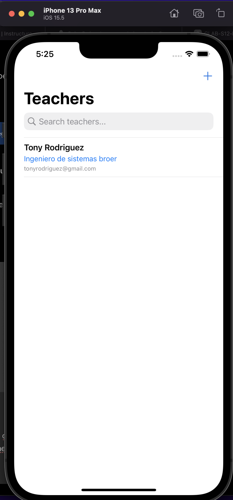
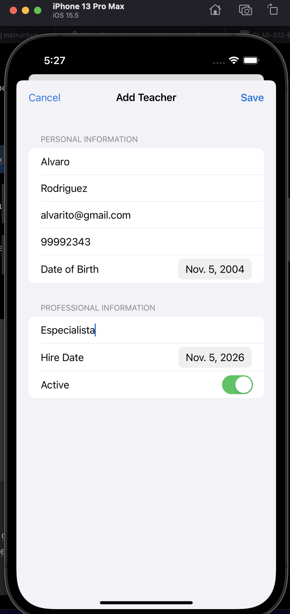
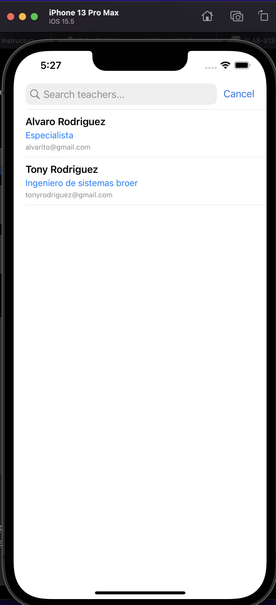
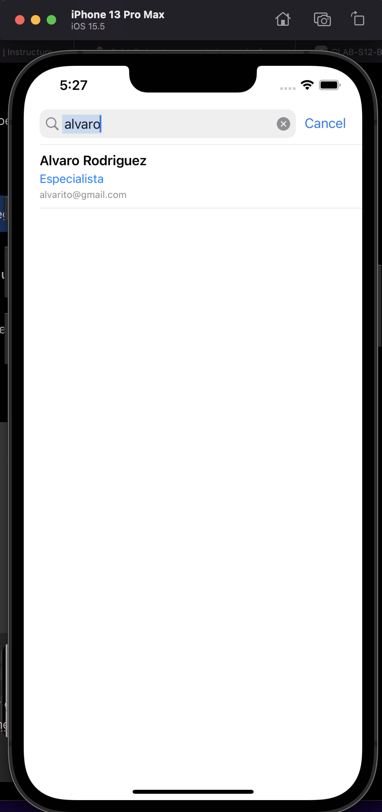
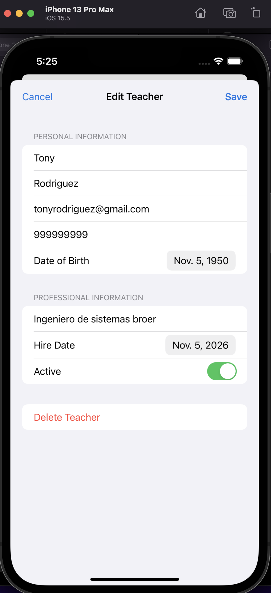

# CRUD de Docentes — SwiftUI

Aplicación iOS para administrar docentes mediante una interfaz construida completamente con **SwiftUI**. Permite registrar, consultar, buscar, modificar y eliminar información de docentes.

## Tecnologías y compatibilidad

- **Interfaz:** SwiftUI (sin Storyboard).
- **Versión ejecutada en las capturas:** `DocentesCompat`, con **Core Data** para persistencia local.
- **Entorno de las capturas:** iPhone 13 Pro Max, iOS 15.5.
- **Versión alternativa del paquete:** `DocentesSwiftData`, preparada para Xcode 15 o superior e iOS 17 o superior.

> **Nota:** las siguientes capturas pertenecen a la versión **Core Data**. Aunque ambas versiones usan SwiftUI, Core Data no es SwiftData.

## Funcionalidades

- Registro de docentes con nombre, apellido, correo, teléfono y fecha de nacimiento.
- Información profesional: especialidad, fecha de contratación y estado activo.
- Listado de docentes y búsqueda por nombre o apellido.
- Actualización y eliminación de registros.
- Almacenamiento local de información.

## 1. Pantalla principal

La pantalla **Teachers** presenta los registros guardados, mostrando el nombre, la especialidad y el correo de cada docente. El botón `+` permite abrir el formulario de registro.

## 2. Registro de un docente

Desde **Add Teacher** es posible completar los datos personales y profesionales del nuevo docente y guardarlos con el botón **Save**.

## 3. Lista de docentes registrados

Al guardar más de un docente, los registros aparecen juntos en la lista principal para su consulta.

## 4. Búsqueda de docentes

El campo **Search teachers...** permite filtrar los registros. En el ejemplo se busca por el nombre **Alvaro**.

## 5. Edición de un docente

Al seleccionar un registro, la vista **Edit Teacher** permite modificar los datos y guardarlos nuevamente. La pantalla también muestra la opción **Delete Teacher** para eliminarlo.

## Cómo abrir el proyecto

### Mac con Xcode 13 / iOS 15

1. Abre `01_Xcode13_iOS15_CoreData/DocentesCompat.xcodeproj`.
2. Selecciona el simulador **iPhone 13 Pro Max** con iOS 15.5.
3. Compila con `⌘ + B` y ejecuta con `⌘ + R`.

### Mac con Xcode 15+ / iOS 17+

Abre `02_Xcode15_iOS17_SwiftData/DocentesSwiftData.xcodeproj` y utiliza un simulador compatible. Esta versión usa **SwiftData** para la persistencia.

